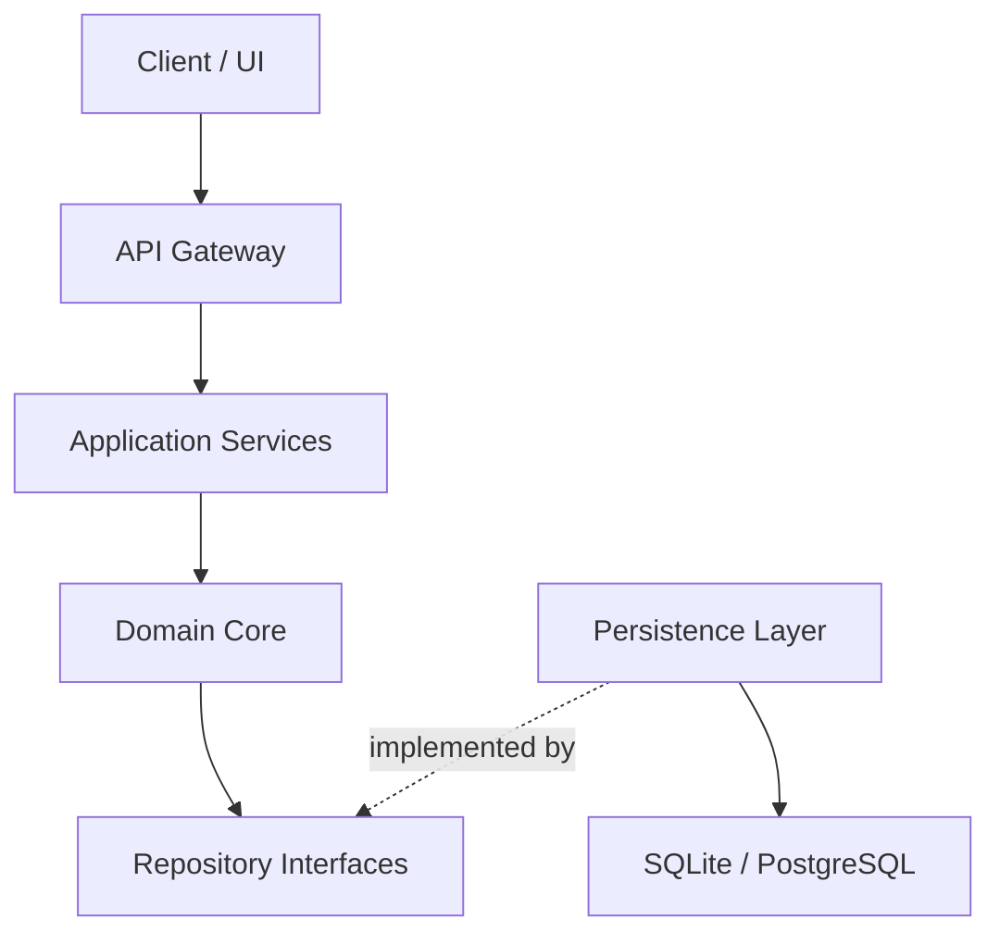
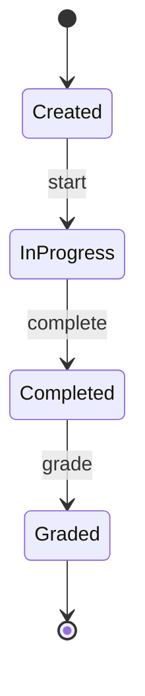

# Examify — Software Architecture Document

* **File:** `SOFTWARE_ARCHITECTURE.md`
* **Architecture baseline:** `1.0`
* **Implementation language:** Python 3.11+
* **Process model:** Cascade / Waterfall
* **Team:** 3 implementation developers and 5 documentation/UML contributors
* **Deployment model:** Modular monolith

This document defines the implementation baseline for Examify. Shared contracts, module boundaries, persistence rules, and lifecycle semantics must be approved before the three implementation branches begin.

> “Frozen” means that changes require a reviewed contract change and corresponding documentation updates. It does not prevent future evolution.

---

## 1. Architectural Style & Layering

### 1.1 Architectural approach
Examify uses a **Layered Modular Architecture** implemented as a modular monolith: one backend application with explicit module boundaries and one relational database.

The logical request flow is:



The API Gateway is the FastAPI entry point inside the monolith. It is not a separate gateway deployment.

The persistence layer implements repository interfaces owned by the domain. The domain never imports SQLAlchemy implementations.

### 1.2 Layer responsibilities

| Layer | Responsibilities | Must not contain |
| :--- | :--- | :--- |
| **Client/UI** | Upload forms, exam interaction, result display, HTTP calls | Correct-answer evaluation, database access, provider credentials |
| **API Gateway** | Routing, authentication, authorization, request validation, CORS, dependency wiring, error translation | SQL queries, adaptive algorithms, question generation logic |
| **Application Services** | Coordinate ingestion, generation, exam execution, transactions, and reporting | HTTP-specific behavior or direct UI dependencies |
| **Domain Core** | Question entities, lifecycle rules, scoring, analytics, repository interfaces | FastAPI, SQLAlchemy, provider SDKs, network calls |
| **Persistence Layer** | SQLAlchemy mappings, repository implementations, transactions, migrations | Adaptive policies, question generation, HTTP responses |

Application coordination is split by use case:
* `services/` owns ingestion, generation, and adaptive difficulty coordination.
* `domain/application/` owns exam execution and analytics coordination.
* `api/bootstrap.py` composes implementations without introducing business rules.

### 1.3 Import rules
Runtime call direction and Python import direction are related but are not identical.

**Allowed dependencies:**
```text
core                    → standard library, Pydantic
domain/entities         → core
domain/patterns         → core, domain/entities
domain/ports            → core, domain/entities
domain/analytics        → core, domain/entities
domain/application      → core, domain entities, patterns, ports, analytics
domain/persistence      → core, domain entities, ports, SQLAlchemy
services                → core, domain entities, domain ports
api                     → core, services, domain application
api/bootstrap.py        → concrete implementations required for composition
client                  → backend HTTP API only
```

**Mandatory rules:**
1. `core/` imports no other Examify package.
2. The domain never imports `services/`, `api/`, or persistence implementations.
3. `services/` never imports `api/` or concrete repositories.
4. Repository interfaces are imported by both application code and persistence implementations.
5. Cross-module communication uses published contracts and ports.
6. Circular imports are prohibited.
7. `TYPE_CHECKING` must not be used to conceal a circular architectural dependency.
8. No module creates a database engine or HTTP client during import.
9. Domain objects are never returned directly as API responses.
10. ORM models never leave persistence implementations.

### 1.4 Core workflow
1. An authenticated user uploads a text-based PDF.
2. The ingestion service validates the upload, computes its SHA-256 digest, and extracts each physical PDF page.
3. Extracted pages retain their original 1-indexed physical page number.
4. The AI adapter receives page-aware chunks and generates candidate questions.
5. Candidates pass schema, citation, and semantic validation before persistence.
6. An exam session starts with a selected document scope and target question count.
7. The backend issues one eligible question at a time.
8. Each accepted answer is evaluated on the server and updates the adaptive difficulty.
9. Completion closes answer submission.
10. Grading produces and stores an analytics report.

Printed page labels may be displayed as supplementary metadata. They never replace physical page indexes in citations.

### 1.5 Operational boundaries
* OCR, scanned-only PDFs, essay grading, and automatic instructor-quality verification are outside the initial release.
* Long-running ingestion and generation execute in a bounded worker, not on the ASGI event loop.
* The initial worker may run in the same deployment. Durable processing state is stored in the database.
* Uploads are private and stored outside the publicly served directory.
* Every operation checks ownership or an explicit instructor sharing permission.
* Logs contain request IDs and entity IDs, not PDF text, passwords, API keys, or complete provider responses.
* External AI transmission requires an enabled institutional policy and an authorized user choice.
* Configurable limits cover upload bytes, page count, extracted characters, provider tokens, request rate, and generation duration.

---

## 2. Python Technology Stack

### 2.1 Approved components

| Component | Library / runtime | Architectural justification |
| :--- | :--- | :--- |
| **Runtime** | Python 3.11+ | Type annotations, modern typing, broad deployment support |
| **HTTP framework** | `fastapi` | Typed request handling, dependency injection, OpenAPI generation |
| **ASGI server** | `uvicorn` | Runs FastAPI in development and deployment |
| **Validation** | `pydantic` V2 | Shared validated DTOs and JSON serialization |
| **Configuration** | `pydantic-settings` | Validated environment configuration |
| **Persistence** | `sqlalchemy` 2.x | ORM mappings, explicit transactions, SQLite/PostgreSQL support |
| **Local database** | SQLite through `sqlite3` | Simple laptop setup and isolated tests |
| **Deployment database** | PostgreSQL with `psycopg` 3 | Concurrent writes, transactions, operational scalability |
| **Migrations** | `alembic` | Reviewed and versioned database changes |
| **PDF extraction** | `pypdf` | Page-level extraction from text-based PDFs |
| **Provider HTTP** | `httpx` | Async client, connection pooling, explicit timeouts |
| **File uploads** | `python-multipart` | FastAPI multipart upload parsing |
| **Testing** | `pytest`, `pytest-asyncio` | Unit, async, integration, and contract tests |
| **Password hashing** | `pwdlib[argon2]` | Argon2 password hashing for local credentials |
| **Token validation** | `PyJWT` | Signed access-token encoding and validation |
| **Architecture checks** | `import-linter` | Enforce published import boundaries |
| **Formatting / linting** | `ruff` | Consistent checks across three laptops |

`requests` is not a baseline dependency. `httpx` provides both sync and async clients, avoiding two HTTP stacks. If legacy integration requires `requests`, it must remain behind an adapter and must not block the async event loop.

### 2.2 Version policy
The table fixes library identities and required major API families. Exact patch versions and transitive dependencies must be resolved into `uv.lock` during baseline setup.

All three developers use:
* The same pinned Python minor version, initially Python 3.11.
* The same committed `pyproject.toml` and `uv.lock`.
* `uv sync --frozen` for reproducible installation.
* Dependency updates through a dedicated reviewed change.

Python 3.12+ compatibility is accepted only after CI validation.

### 2.3 Execution and persistence model
* Provider calls use `httpx.AsyncClient`.
* PDF processing runs in a bounded worker or thread execution context.
* SQLAlchemy uses its synchronous API initially.
* Synchronous database units of work execute outside the ASGI event loop.
* A SQLAlchemy `Session` is scoped to one unit of work and never shared across threads.
* No database transaction remains open while waiting for an LLM response.
* SQLite enables foreign keys, WAL mode, and a bounded busy timeout.
* PostgreSQL integration tests validate deployment behavior that SQLite cannot reproduce.

### 2.4 Provider resilience
Provider configuration includes:
* Connection and response timeouts.
* A total generation deadline.
* Bounded concurrency.
* At most two retries after the initial attempt for transient failures.
* Exponential backoff with jitter, constrained by the total deadline.
* Respect for `Retry-After` within that deadline.
* No retry for authentication or invalid configuration errors.

Fallback follows the policy in Section 3.1. Validation failure never allows unvalidated questions into the database.

---

## 3. GoF Design Patterns Specification — Blueprints & Signatures

> Repository is an architectural persistence pattern rather than one of the original GoF patterns. It is specified here alongside the required GoF patterns.

All signatures below are normative. Shared supporting value objects belong in `core/types.py`.

```python
from dataclasses import dataclass
from datetime import datetime
from typing import Literal
from uuid import UUID

from core.schemas import Difficulty, QuestionPayload


@dataclass(frozen=True)
class ExtractedPage:
    document_id: UUID
    page_number: int
    text: str


@dataclass(frozen=True)
class GenerationRequest:
    document_id: UUID
    pages: tuple[ExtractedPage, ...]
    question_count: int
    difficulty: Difficulty
    language: str
    seed: int = 0


@dataclass(frozen=True)
class GenerationBatch:
    questions: tuple[QuestionPayload, ...]
    generation_mode: Literal["live", "mock"]
    provider: str
    fallback_reason: str | None
    warnings: tuple[str, ...]


@dataclass(frozen=True)
class PerformanceSnapshot:
    answered_count: int
    recent_correctness: tuple[bool, ...]


@dataclass(frozen=True)
class QuestionSpec:
    question_id: UUID
    kind: Literal["multiple_choice", "true_false"]
    prompt: str
    options: tuple[str, ...]
    correct_index: int
    difficulty: Difficulty
    explanation: str


@dataclass(frozen=True)
class Question:
    question_id: UUID
    kind: str
    prompt: str
    options: tuple[str, ...]
    correct_index: int
    difficulty: Difficulty
    explanation: str

    def is_correct(self, selected_index: int) -> bool:
        return selected_index == self.correct_index
```

Supporting types must enforce their invariants through constructors or boundary validation; annotations alone do not validate dataclasses.

### 3.1 Adapter Pattern — `AIAdapter`
**Purpose:** Decouple internal question generation from provider request formats, authentication, and response formats.

```python
from abc import ABC, abstractmethod
import httpx

from core.types import GenerationBatch, GenerationRequest


class AIAdapter(ABC):
    @abstractmethod
    async def generate_questions(
        self,
        request: GenerationRequest,
    ) -> GenerationBatch:
        ...


class ExternalLLMAdapter(AIAdapter):
    def __init__(
        self,
        client: httpx.AsyncClient,
        base_url: str,
        api_key: str,
        model: str,
    ) -> None:
        ...

    async def generate_questions(
        self,
        request: GenerationRequest,
    ) -> GenerationBatch:
        ...


class OfflineMockAIAdapter(AIAdapter):
    async def generate_questions(
        self,
        request: GenerationRequest,
    ) -> GenerationBatch:
        ...


class FallbackAIAdapter(AIAdapter):
    def __init__(
        self,
        primary: AIAdapter,
        fallback: AIAdapter,
        policy: "FallbackPolicy",
    ) -> None:
        ...

    async def generate_questions(
        self,
        request: GenerationRequest,
    ) -> GenerationBatch:
        ...
```

`FallbackAIAdapter` wraps adapters and adds resilience; structurally it also acts as a decorator.

**Behavior:**
* External responses are parsed into `QuestionPayload`.
* Every cited page must belong to the supplied document and permitted page set.
* Each source excerpt must occur within its cited page after documented whitespace normalization.
* One bounded repair attempt may be made for malformed output.
* Timeouts, network failures, exhausted transient retries, malformed output, and unavailable provider configuration activate fallback when policy permits.
* Explicit offline mode directly selects the mock adapter.
* Programming errors are propagated; they are not converted silently into mock output.
* Fallback reasons are persisted and visible.
* Mock generation is deterministic for the same normalized input and seed.
* Mock questions use source-derived templates and actual page excerpts. They do not invent page references.
* If the source cannot support a requested count, generation returns fewer questions with a warning or raises `InsufficientSourceContentError`.
* Mock questions carry `generation_mode="mock"` and require explicit instructor approval before use in graded exams.

Quotation checks confirm traceability, not educational correctness. Instructor review remains necessary for approved assessments.

### 3.2 Strategy Pattern — `DifficultyStrategy`
**Purpose:** Replace adaptive algorithms without changing exam orchestration.

```python
from abc import ABC, abstractmethod

from core.schemas import Difficulty
from core.types import PerformanceSnapshot


class DifficultyStrategy(ABC):
    @abstractmethod
    def next_difficulty(
        self,
        current: Difficulty,
        performance: PerformanceSnapshot,
    ) -> Difficulty:
        ...


class ConsecutiveAnswersStrategy(DifficultyStrategy):
    def next_difficulty(
        self,
        current: Difficulty,
        performance: PerformanceSnapshot,
    ) -> Difficulty:
        ...


class RollingAccuracyStrategy(DifficultyStrategy):
    def __init__(self, window_size: int = 5) -> None:
        ...

    def next_difficulty(
        self,
        current: Difficulty,
        performance: PerformanceSnapshot,
    ) -> Difficulty:
        ...
```

**Baseline algorithm:**
* Start at `Medium`.
* Evaluate the most recent two accepted answers.
* Two correct answers increase difficulty by one level.
* Two incorrect answers decrease difficulty by one level.
* Otherwise, retain difficulty.
* Clamp changes at `Easy` and `Hard`.
* Evaluate once per newly accepted answer; retries never cause additional changes.

**Alternative algorithm:**
* Use a rolling window of five accepted answers.
* Retain difficulty until the window is full.
* Accuracy >= 80% increases one level.
* Accuracy <= 40% decreases one level.
* Otherwise retain difficulty.

**Question selection:**
1. Select an unanswered eligible question at the target difficulty.
2. If exhausted, choose the nearest available difficulty.
3. Resolve an equal-distance tie toward the easier level.
4. Never repeat a question within the same session.
5. If the entire pool is exhausted, complete with reason `pool_exhausted`.
6. Persist the actual target count as the number answered.

Difficulty adaptation changes question selection. The initial score is an unweighted accuracy score and must not be described as a calibrated ability estimate.

### 3.3 Factory Method Pattern — `QuestionFactory`
**Purpose:** Instantiate question types through overridable creation methods.

```python
from abc import ABC, abstractmethod

from core.types import Question, QuestionSpec


class MultipleChoiceQuestion(Question):
    ...


class TrueFalseQuestion(Question):
    ...


class QuestionFactory(ABC):
    def create(self, spec: QuestionSpec) -> Question:
        self.validate(spec)
        return self.create_question(spec)

    @abstractmethod
    def validate(self, spec: QuestionSpec) -> None:
        ...

    @abstractmethod
    def create_question(self, spec: QuestionSpec) -> Question:
        ...


class MultipleChoiceQuestionFactory(QuestionFactory):
    def validate(self, spec: QuestionSpec) -> None:
        ...

    def create_question(
        self,
        spec: QuestionSpec,
    ) -> MultipleChoiceQuestion:
        ...


class TrueFalseQuestionFactory(QuestionFactory):
    def validate(self, spec: QuestionSpec) -> None:
        ...

    def create_question(
        self,
        spec: QuestionSpec,
    ) -> TrueFalseQuestion:
        ...
```

The overridden `create_question()` is the Factory Method. A registry in dependency wiring selects the concrete factory by `spec.kind`.
* Multiple-choice questions require 2–6 distinct, nonblank options.
* True/false questions require exactly `("True", "False")`.
* Both require an in-range, zero-based `correct_index`.
* Initial API contracts expose multiple-choice questions only.
* True/false API support requires a reviewed contract extension.

### 3.4 State Pattern — `ExamState` and `ExamSession`

```python
from abc import ABC, abstractmethod
from datetime import datetime
from uuid import UUID

from core.schemas import AnswerSubmission, ExamResultReport


class ExamState(ABC):
    @property
    @abstractmethod
    def name(self) -> str:
        ...

    @abstractmethod
    def start(self, session: "ExamSession", now: datetime) -> None:
        ...

    @abstractmethod
    def submit_answer(
        self,
        session: "ExamSession",
        answer: AnswerSubmission,
        now: datetime,
    ) -> None:
        ...

    @abstractmethod
    def complete(self, session: "ExamSession", now: datetime) -> None:
        ...

    @abstractmethod
    def grade(
        self,
        session: "ExamSession",
        report: ExamResultReport,
        now: datetime,
    ) -> None:
        ...


class CreatedState(ExamState):
    ...


class InProgressState(ExamState):
    ...


class CompletedState(ExamState):
    ...


class GradedState(ExamState):
    ...


class ExamSession:
    def __init__(
        self,
        session_id: UUID,
        student_id: UUID,
        state: ExamState,
    ) -> None:
        ...

    def start(self, now: datetime) -> None:
        ...

    def submit_answer(
        self,
        answer: AnswerSubmission,
        now: datetime,
    ) -> None:
        ...

    def complete(self, now: datetime) -> None:
        ...

    def grade(
        self,
        report: ExamResultReport,
        now: datetime,
    ) -> None:
        ...
```



| State | Permitted commands | Preconditions |
| :--- | :--- | :--- |
| **Created** | `start` | Authorized student and nonempty eligible question pool |
| **InProgress** | `submit_answer`, `complete` | Issued question matches; answer valid; session writable |
| **Completed** | `grade` | No further answers accepted; answer set fixed |
| **Graded** | Read report | Report persisted; lifecycle terminal |

All other transitions raise `InvalidExamTransitionError`.

Command idempotency is handled by the application layer. It may return an existing successful result without invoking a state transition again.

### 3.5 Repository Pattern
Interfaces live in `domain/ports/repositories.py`. Implementations live in `domain/persistence/repositories/`.

```python
from typing import Protocol
from uuid import UUID

from core.schemas import Difficulty, QuestionPayload
from core.types import ExtractedPage
from domain.entities.document import Document
from domain.entities.exam_session import ExamSession


class DocumentRepository(Protocol):
    def get(self, document_id: UUID) -> Document | None:
        ...

    def add(self, document: Document) -> None:
        ...

    def save(self, document: Document) -> None:
        ...

    def replace_pages(
        self,
        document_id: UUID,
        pages: tuple[ExtractedPage, ...],
    ) -> None:
        ...

    def list_pages(
        self,
        document_id: UUID,
    ) -> tuple[ExtractedPage, ...]:
        ...


class QuestionRepository(Protocol):
    def get(self, question_id: UUID) -> QuestionPayload | None:
        ...

    def add_many(
        self,
        questions: tuple[QuestionPayload, ...],
    ) -> None:
        ...

    def find_candidates(
        self,
        document_ids: tuple[UUID, ...],
        difficulty: Difficulty,
        excluded_ids: frozenset[UUID],
        approved_only: bool,
        limit: int,
    ) -> tuple[QuestionPayload, ...]:
        ...


class ExamSessionRepository(Protocol):
    def get(self, session_id: UUID) -> ExamSession | None:
        ...

    def add(self, session: ExamSession) -> None:
        ...

    def save(
        self,
        session: ExamSession,
        expected_version: int,
    ) -> None:
        ...
```

**Additional interfaces:**
* `ExamAnswerRepository`: issue questions, retrieve accepted submissions, persist answers.
* `UnitOfWork`: expose repositories, commit, and rollback.
* `UnitOfWorkFactory`: create a fresh unit of work.

Concrete classes are named `SQLAlchemyDocumentRepository`, `SQLAlchemyQuestionRepository`, `SQLAlchemyExamSessionRepository`, `SQLAlchemyExamAnswerRepository`, and `SQLAlchemyUnitOfWork`.

Repositories never commit independently. The application service controls the transaction through `UnitOfWork`.

### 3.6 Shared application entry points

```python
class PDFExtractionService:
    def extract(
        self,
        document_id: UUID,
        pdf_path: "Path",
    ) -> tuple[ExtractedPage, ...]:
        ...


class QuestionGenerationService:
    async def generate(
        self,
        actor_id: UUID,
        request: GenerationRequest,
    ) -> GenerationBatch:
        ...


class ExamApplicationService:
    def start(
        self,
        actor_id: UUID,
        session_id: UUID,
    ) -> None:
        ...

    def next_question(
        self,
        actor_id: UUID,
        session_id: UUID,
    ) -> "ExamQuestionView":
        ...

    def submit_answer(
        self,
        actor_id: UUID,
        answer: AnswerSubmission,
    ) -> "AnswerReceipt":
        ...

    def complete(
        self,
        actor_id: UUID,
        session_id: UUID,
    ) -> None:
        ...

    def grade(
        self,
        actor_id: UUID,
        session_id: UUID,
    ) -> ExamResultReport:
        ...


class AnalyticsService:
    def build_report(
        self,
        session: ExamSession,
        answers: tuple["EvaluatedAnswer", ...],
        generated_at: datetime,
    ) -> ExamResultReport:
        ...
```

`ExamQuestionView`, `AnswerReceipt`, and `EvaluatedAnswer` are baseline types in `core/types.py`. The student view contains no `correct_index`, `explanation`, or source excerpt.

---

## 4. Frozen Shared Data Contracts — `core/schemas.py`

### 4.1 Contract rules
* All models use Pydantic V2.
* Models reject unknown fields.
* Models are frozen and contain immutable nested collections.
* UUIDs are serialized as strings.
* Timestamps must include timezone information; the application emits UTC.
* Physical PDF page numbers are **1-indexed**.
* Option indexes are **0-indexed**.
* Accuracy and scores range from `0.0` to `1.0`.
* Text normalization never changes stored physical page numbering.
* Schema changes require baseline review and contract tests.

### 4.2 Complete models

```python
from __future__ import annotations

from enum import Enum
from typing import Annotated, Literal, Self
from uuid import UUID

from pydantic import (
    AwareDatetime,
    BaseModel,
    ConfigDict,
    Field,
    StringConstraints,
    model_validator,
)


NonEmptyText = Annotated[
    str,
    StringConstraints(strip_whitespace=True, min_length=1),
]
PositiveInt = Annotated[int, Field(strict=True, ge=1)]
NonNegativeInt = Annotated[int, Field(strict=True, ge=0)]
Ratio = Annotated[float, Field(ge=0.0, le=1.0, allow_inf_nan=False)]
Sha256 = Annotated[str, StringConstraints(pattern=r"^[0-9a-f]{64}$")]


class FrozenContract(BaseModel):
    model_config = ConfigDict(
        frozen=True,
        extra="forbid",
        allow_inf_nan=False,
    )


class Difficulty(str, Enum):
    EASY = "Easy"
    MEDIUM = "Medium"
    HARD = "Hard"


class DocumentStatus(str, Enum):
    UPLOADED = "Uploaded"
    PROCESSING = "Processing"
    READY = "Ready"
    FAILED = "Failed"


class DocumentUploadResponse(FrozenContract):
    schema_version: Literal["1.0"] = "1.0"
    document_id: UUID
    filename: NonEmptyText
    sha256: Sha256
    size_bytes: PositiveInt
    status: DocumentStatus
    page_count: PositiveInt | None = None
    extracted_page_count: NonNegativeInt = 0
    uploaded_at: AwareDatetime
    warnings: tuple[NonEmptyText, ...] = ()
    error_code: NonEmptyText | None = None

    @model_validator(mode="after")
    def validate_processing_status(self) -> Self:
        if self.page_count is None:
            if self.extracted_page_count != 0:
                raise ValueError(
                    "extracted pages require a known page_count"
                )
        elif self.extracted_page_count > self.page_count:
            raise ValueError(
                "extracted_page_count cannot exceed page_count"
            )

        if self.status == DocumentStatus.READY:
            if self.page_count is None:
                raise ValueError("Ready documents require page_count")
            if self.extracted_page_count < 1:
                raise ValueError(
                    "Ready documents require extractable text"
                )

        if self.status == DocumentStatus.FAILED:
            if self.error_code is None:
                raise ValueError(
                    "Failed documents require error_code"
                )
        elif self.error_code is not None:
            raise ValueError(
                "error_code is valid only for Failed documents"
            )

        return self


class SourceMeta(FrozenContract):
    document_id: UUID
    page_number: PositiveInt
    excerpt: NonEmptyText


class QuestionPayload(FrozenContract):
    schema_version: Literal["1.0"] = "1.0"
    question_id: UUID
    question_type: Literal["multiple_choice"] = "multiple_choice"
    prompt: NonEmptyText
    options: tuple[NonEmptyText, ...] = Field(
        min_length=2,
        max_length=6,
    )
    correct_index: NonNegativeInt
    difficulty: Difficulty
    explanation: NonEmptyText
    topic: NonEmptyText
    sources: tuple[SourceMeta, ...] = Field(min_length=1)
    generation_mode: Literal["live", "mock"]
    provider: NonEmptyText
    created_at: AwareDatetime

    @model_validator(mode="after")
    def validate_question(self) -> Self:
        if self.correct_index >= len(self.options):
            raise ValueError("correct_index is outside options")

        normalized_options = tuple(
            " ".join(option.split()).casefold()
            for option in self.options
        )
        if len(set(normalized_options)) != len(normalized_options):
            raise ValueError("options must be distinct")

        document_ids = {
            source.document_id for source in self.sources
        }
        if len(document_ids) != 1:
            raise ValueError(
                "baseline questions must cite one document"
            )

        source_keys = {
            (
                source.document_id,
                source.page_number,
                source.excerpt,
            )
            for source in self.sources
        }
        if len(source_keys) != len(self.sources):
            raise ValueError("duplicate source references")

        return self


class AnswerSubmission(FrozenContract):
    schema_version: Literal["1.0"] = "1.0"
    submission_id: UUID
    session_id: UUID
    question_id: UUID
    selected_index: NonNegativeInt


class TopicPerformance(FrozenContract):
    topic: NonEmptyText
    answered_count: PositiveInt
    correct_count: NonNegativeInt
    accuracy: Ratio
    insufficient_evidence: bool
    sources: tuple[SourceMeta, ...] = Field(min_length=1)

    @model_validator(mode="after")
    def validate_counts(self) -> Self:
        if self.correct_count > self.answered_count:
            raise ValueError(
                "correct_count cannot exceed answered_count"
            )

        expected = self.correct_count / self.answered_count
        if abs(self.accuracy - expected) > 1e-9:
            raise ValueError(
                "accuracy must equal correct_count / answered_count"
            )

        if self.insufficient_evidence != (
            self.answered_count < 3
        ):
            raise ValueError(
                "insufficient_evidence must reflect the "
                "three-answer minimum"
            )

        return self


class PracticeRecommendation(FrozenContract):
    topic: NonEmptyText
    reason: NonEmptyText
    suggested_difficulty: Difficulty
    recommended_question_count: PositiveInt
    sources: tuple[SourceMeta, ...] = Field(min_length=1)


class ExamResultReport(FrozenContract):
    schema_version: Literal["1.0"] = "1.0"
    session_id: UUID
    student_id: UUID
    state: Literal["Graded"] = "Graded"
    completion_reason: Literal[
        "target_reached",
        "user_finished",
        "pool_exhausted",
    ]
    target_question_count: PositiveInt
    answered_count: NonNegativeInt
    correct_count: NonNegativeInt
    score_ratio: Ratio | None
    final_difficulty: Difficulty
    topic_performance: tuple[TopicPerformance, ...] = ()
    weak_topics: tuple[NonEmptyText, ...] = ()
    recommendations: tuple[PracticeRecommendation, ...] = ()
    generated_at: AwareDatetime

    @model_validator(mode="after")
    def validate_report(self) -> Self:
        if self.answered_count > self.target_question_count:
            raise ValueError(
                "answered_count cannot exceed target_question_count"
            )
        if self.correct_count > self.answered_count:
            raise ValueError(
                "correct_count cannot exceed answered_count"
            )

        if self.answered_count == 0:
            if self.score_ratio is not None:
                raise ValueError(
                    "empty exams require score_ratio=None"
                )
        else:
            expected = self.correct_count / self.answered_count
            if self.score_ratio is None:
                raise ValueError(
                    "answered exams require score_ratio"
                )
            if abs(self.score_ratio - expected) > 1e-9:
                raise ValueError("score_ratio is inconsistent")

        topics = {
            item.topic: item for item in self.topic_performance
        }
        if len(topics) != len(self.topic_performance):
            raise ValueError("duplicate topic performance entries")

        if (
            sum(
                item.answered_count for item in topics.values()
            )
            != self.answered_count
        ):
            raise ValueError("topic answer totals are inconsistent")

        if (
            sum(
                item.correct_count for item in topics.values()
            )
            != self.correct_count
        ):
            raise ValueError("topic correct totals are inconsistent")

        expected_weak = {
            topic
            for topic, item in topics.items()
            if not item.insufficient_evidence
            and item.accuracy < 0.60
        }
        if (
            len(set(self.weak_topics)) != len(self.weak_topics)
            or set(self.weak_topics) != expected_weak
        ):
            raise ValueError("weak_topics are inconsistent")

        recommended_topics = tuple(
            item.topic for item in self.recommendations
        )
        if (
            len(set(recommended_topics)) != len(recommended_topics)
            or set(recommended_topics) != expected_weak
        ):
            raise ValueError(
                "exactly one recommendation is required "
                "for each weak topic"
            )

        return self
```

### 4.3 Boundary validation beyond Pydantic
The application must additionally verify:
* A referenced document exists and is accessible to the actor.
* Cited pages exist in that document.
* Source excerpts match the extracted pages.
* A submitted option exists for the issued question.
* The question belongs to the specified session.
* A submitted question is currently awaiting an answer.
* The session belongs to the authenticated student.
* The same submission ID is not reused with a different payload.

`QuestionPayload` is an internal generation and instructor-review contract. Student endpoints use an explicit safe response model containing question ID, prompt, options, difficulty, and sequence number.

Never serialize `QuestionPayload` directly to a student during an active exam.

---

## 5. Database Schema & Persistence Design

### 5.1 Common conventions
* UUIDs use PostgreSQL `UUID`; SQLite stores canonical UUID strings.
* Timestamps use PostgreSQL `TIMESTAMPTZ`; SQLite stores normalized UTC timestamps through a tested SQLAlchemy type.
* Enumerations use portable strings with `CHECK` constraints.
* Flexible structured fields use JSON, mapped to `JSONB` in PostgreSQL.
* JSON contents are validated by the application; JSON columns do not replace relational foreign keys.
* User-facing deletion initially uses soft deletion.
* Historical questions and completed exam records are immutable.
* Foreign keys use `RESTRICT` unless a documented purge operation explicitly manages deletion.

### 5.2 `users`

| Column | Type | Constraints |
| :--- | :--- | :--- |
| `id` | `UUID` | Primary key |
| `email_normalized` | `VARCHAR(320)` | Unique, not null |
| `password_hash` | `TEXT` | Not null for local authentication |
| `role` | `VARCHAR(20)` | `student` or `instructor` |
| `is_active` | `BOOLEAN` | Not null, default true |
| `created_at` | `Timestamp` | Not null |

Passwords are never stored or logged in plaintext.

### 5.3 `documents`

| Column | Type | Constraints |
| :--- | :--- | :--- |
| `id` | `UUID` | Primary key |
| `owner_id` | `UUID` | FK -> `users.id`, not null |
| `filename` | `VARCHAR(255)` | Sanitized display name, not null |
| `storage_key` | `TEXT` | Unique, not null; generated by server |
| `sha256` | `CHAR(64)` | Not null |
| `size_bytes` | `BIGINT` | Greater than zero |
| `status` | `VARCHAR(20)` | `Uploaded` / `Processing` / `Ready` / `Failed` |
| `page_count` | `INTEGER` | Nullable until parsed; positive when set |
| `extracted_page_count` | `INTEGER` | Default zero; nonnegative |
| `error_code` | `VARCHAR(80)` | Nullable |
| `processing_lease_until` | `Timestamp` | Nullable; worker recovery |
| `created_at` | `Timestamp` | Not null |
| `updated_at` | `Timestamp` | Not null |
| `deleted_at` | `Timestamp` | Nullable |

**Indexes:**
* `(owner_id, created_at)`
* `(owner_id, sha256)` for duplicate detection
* `(status, processing_lease_until)` for worker recovery

A matching hash does not reveal another user's upload.

### 5.4 `questions`

| Column | Type | Constraints |
| :--- | :--- | :--- |
| `id` | `UUID` | Primary key |
| `document_id` | `UUID` | FK -> `documents.id`, not null |
| `question_type` | `VARCHAR(30)` | Supported factory type |
| `prompt` | `TEXT` | Not null |
| `options` | `JSON` | Not null |
| `correct_index` | `INTEGER` | Nonnegative |
| `difficulty` | `VARCHAR(10)` | `Easy` / `Medium` / `Hard` |
| `explanation` | `TEXT` | Not null |
| `topic` | `VARCHAR(200)` | Not null |
| `generation_mode` | `VARCHAR(10)` | `live` / `mock` |
| `provider` | `VARCHAR(100)` | Not null |
| `review_status` | `VARCHAR(20)` | `pending` / `approved` / `rejected` |
| `reviewed_by` | `UUID` | Nullable FK -> `users.id` |
| `reviewed_at` | `Timestamp` | Nullable |
| `generation_run_id` | `UUID` | FK -> `generation_runs.id` |
| `content_hash` | `CHAR(64)` | Not null |
| `created_at` | `Timestamp` | Not null |

**Indexes:**
* `(document_id, review_status, difficulty)`
* `(document_id, topic)`
* `(generation_run_id)`
* Unique `(document_id, content_hash)`

Edits create a replacement question with a new ID. Existing questions referenced by exams are not rewritten.

### 5.5 `exam_sessions`

| Column | Type | Constraints |
| :--- | :--- | :--- |
| `id` | `UUID` | Primary key |
| `student_id` | `UUID` | FK -> `users.id`, not null |
| `state` | `VARCHAR(20)` | `Created` / `InProgress` / `Completed` / `Graded` |
| `mode` | `VARCHAR(20)` | `practice` / `graded` |
| `target_question_count` | `INTEGER` | Positive |
| `current_difficulty` | `VARCHAR(10)` | `Easy` / `Medium` / `Hard` |
| `strategy_name` | `VARCHAR(80)` | Not null |
| `strategy_version` | `VARCHAR(30)` | Not null |
| `strategy_config` | `JSON` | Not null |
| `version` | `INTEGER` | Nonnegative; optimistic concurrency |
| `completion_reason` | `VARCHAR(30)` | Nullable until completion |
| `result_report` | `JSON` | Nullable until graded |
| `created_at` | `Timestamp` | Not null |
| `started_at` | `Timestamp` | Nullable |
| `completed_at` | `Timestamp` | Nullable |
| `graded_at` | `Timestamp` | Nullable |

**Indexes:**
* `(student_id, created_at)`
* `(student_id, state)`

### 5.6 `exam_answers`
A row is created when a question is issued. It is completed when an answer is accepted.

| Column | Type | Constraints |
| :--- | :--- | :--- |
| `id` | `UUID` | Primary key |
| `session_id` | `UUID` | FK -> `exam_sessions.id`, not null |
| `question_id` | `UUID` | FK -> `questions.id`, not null |
| `sequence_number` | `INTEGER` | Positive |
| `submission_id` | `UUID` | Nullable; unique when set |
| `selected_index` | `INTEGER` | Nullable; nonnegative when set |
| `is_correct` | `BOOLEAN` | Nullable until answered |
| `difficulty_at_issue` | `VARCHAR(10)` | Not null |
| `question_snapshot` | `JSON` | Not null; internal immutable snapshot |
| `issued_at` | `Timestamp` | Not null |
| `answered_at` | `Timestamp` | Nullable |

**Constraints:**
* Unique `(session_id, question_id)`
* Unique `(session_id, sequence_number)`
* Unique non-null `submission_id`
* Answer fields are either all unfilled or all populated.

**Indexes:**
* `(session_id, answered_at)`
* `(question_id)`

The snapshot includes the internal answer key and citations. It is never exposed through the student question endpoint.

### 5.7 Required supporting tables
The five principal tables are insufficient for normalized page citations and reproducible sessions. The following tables are mandatory:

| Table | Essential columns and constraints |
| :--- | :--- |
| `document_pages` | `document_id` FK, `page_number` positive, `text` TEXT, `text_sha256`; composite PK `(document_id, page_number)` |
| `question_sources` | `question_id`, `document_id`, `page_number`, `excerpt`; PK `(question_id, document_id, page_number)`; composite FK to `document_pages` |
| `exam_session_documents` | `session_id`, `document_id`; composite PK |
| `exam_session_questions` | `session_id`, `question_id`; composite PK; frozen eligible pool |
| `generation_runs` | `id`, `document_id`, `requested_by`, `status`, `request_config`, `mode`, `provider`, `fallback_reason`, timestamps, `processing_lease_until` |
| `document_permissions` | `document_id`, `user_id`, `permission`; composite PK for explicit sharing |

`question_sources` also uses a composite foreign key to `(questions.id, questions.document_id)`, supported by a matching unique constraint. This ensures citations belong to the question's document.

There is one citation entry per question and physical page. If multiple passages are used on a page, store one encompassing excerpt.

### 5.8 Transaction and concurrency rules
**Answer submission transaction:**
1. Verify ownership and session state.
2. Check whether `submission_id` already exists.
3. If the existing payload matches, return the original receipt.
4. If it differs, return an idempotency conflict.
5. Verify the issued question and option index.
6. Evaluate correctness from the server snapshot.
7. Persist the answer.
8. Update difficulty and increment session version.
9. Commit atomically.

Every session mutation uses a conditional version update:

```sql
UPDATE exam_sessions
SET version = version + 1
WHERE id = :session_id
  AND version = :expected_version;
```

Zero affected rows means a concurrency conflict; the transaction rolls back.

Only one unanswered issued question is permitted per session. Version checks serialize concurrent issuance and submission. Unique constraints provide additional protection.

The eligible pool is frozen at session start. Newly generated questions cannot change an ongoing exam.

### 5.9 Analytics rules
* One primary topic is assigned to each question.
* Overall score = accepted correct answers / accepted answers.
* An empty completed exam has `score_ratio = null`.
* A topic is weak when accuracy is below 60% with at least three accepted answers.
* Topics with fewer than three answers are marked as insufficient evidence.
* Each weak topic receives one recommendation for five practice questions.
* Recommended difficulty is `Easy` below 40% topic accuracy and `Medium` otherwise.
* Recommendations cite the relevant source pages, prioritizing incorrectly answered questions.
* Reports describe observed performance, not a definitive diagnosis of mastery.
* Grading and report persistence occur in one transaction.

### 5.10 Migrations, recovery, and retention
* Alembic is the only production schema-change mechanism.
* `create_all()` is limited to isolated tests.
* Upload files are written to temporary storage and atomically renamed.
* Database processing states and expiring leases permit recovery after worker interruption.
* Failed ingestion cannot produce a `Ready` document.
* Backups include both the database and private PDF storage.
* A restore test is required before deployment acceptance.
* Purge operations must account for exam history and citation retention.

---

## 6. Repository Folder Structure & 3-Branch Conflict-Free Partitioning

### 6.1 Exact baseline layout

```text
examify/
├── SOFTWARE_ARCHITECTURE.md
├── README.md
├── AGENTS.md
├── pyproject.toml
├── uv.lock
├── .env.example
├── .gitignore
├── .github/
│   └── workflows/
│       └── ci.yml
├── core/
│   ├── __init__.py
│   ├── schemas.py
│   ├── types.py
│   ├── errors.py
│   └── config.py
├── services/
│   ├── __init__.py
│   ├── ingestion/
│   │   ├── __init__.py
│   │   ├── pdf_extractor.py
│   │   └── document_service.py
│   ├── ai/
│   │   ├── __init__.py
│   │   ├── adapter.py
│   │   ├── external_adapter.py
│   │   ├── mock_adapter.py
│   │   ├── fallback_adapter.py
│   │   ├── validation.py
│   │   └── generation_service.py
│   ├── adaptive/
│   │   ├── __init__.py
│   │   ├── strategy.py
│   │   ├── consecutive.py
│   │   ├── rolling_accuracy.py
│   │   └── engine.py
│   └── workers/
│       ├── __init__.py
│       └── processing_worker.py
├── domain/
│   ├── __init__.py
│   ├── entities/
│   │   ├── __init__.py
│   │   ├── document.py
│   │   ├── question.py
│   │   └── exam_session.py
│   ├── patterns/
│   │   ├── __init__.py
│   │   ├── question_factory.py
│   │   └── exam_states.py
│   ├── ports/
│   │   ├── __init__.py
│   │   ├── repositories.py
│   │   ├── unit_of_work.py
│   │   └── difficulty_policy.py
│   ├── application/
│   │   ├── __init__.py
│   │   └── exam_service.py
│   ├── analytics/
│   │   ├── __init__.py
│   │   └── analytics_service.py
│   └── persistence/
│       ├── __init__.py
│       ├── database.py
│       ├── models.py
│       ├── mappers.py
│       ├── unit_of_work.py
│       ├── repositories/
│       │   ├── __init__.py
│       │   ├── document_repository.py
│       │   ├── question_repository.py
│       │   ├── exam_session_repository.py
│       │   └── exam_answer_repository.py
│       └── migrations/
│           ├── alembic.ini
│           ├── env.py
│           ├── script.py.mako
│           └── versions/
├── api/
│   ├── __init__.py
│   ├── main.py
│   ├── bootstrap.py
│   ├── dependencies.py
│   ├── auth.py
│   ├── exception_handlers.py
│   ├── response_models.py
│   └── routes/
│       ├── __init__.py
│       ├── auth.py
│       ├── documents.py
│       ├── generation.py
│       ├── exams.py
│       └── health.py
├── client/
│   ├── index.html
│   ├── styles.css
│   └── app.js
├── tests/
│   ├── contracts/
│   │   └── test_shared_contracts.py
│   ├── services/
│   │   ├── conftest.py
│   │   ├── fixtures/
│   │   ├── test_pdf_extraction.py
│   │   ├── test_ai_fallback.py
│   │   └── test_adaptive_strategies.py
│   ├── domain/
│   │   ├── conftest.py
│   │   ├── test_question_factory.py
│   │   ├── test_exam_states.py
│   │   ├── test_repositories.py
│   │   └── test_analytics.py
│   └── api/
│       ├── conftest.py
│       ├── test_authorization.py
│       ├── test_workflow.py
│       └── test_answer_key_redaction.py
└── docs/
    ├── requirements/
    ├── uml/
    ├── traceability/
    ├── acceptance/
    └── operations/
```

Although SQLAlchemy implementations are physically under `domain/persistence/` to satisfy branch ownership, they are architecturally infrastructure. Domain entities, patterns, analytics, and application code must not import that directory.

`domain/ports/difficulty_policy.py` defines the structural interface consumed by exam orchestration. Service-owned strategies implement it without requiring domain-to-services imports.

### 6.2 Baseline freeze before branching
The team creates and merges a baseline commit containing:
* This document.
* All `core/` contracts and supporting types.
* Repository, unit-of-work, and difficulty-policy interfaces.
* Public application signatures.
* Package skeletons.
* Dependency and lock files.
* Shared contract tests.
* CI and import-boundary configuration.
* `.env.example`.
* API request/response specifications.

The baseline is tagged `architecture-v1.0`. All three branches start from that tag.

### 6.3 Exclusive ownership

| Branch | Exclusive implementation ownership | Test ownership |
| :--- | :--- | :--- |
| `feat/services-ai-adaptive` | Entire `services/` tree | `tests/services/` |
| `feat/domain-persistence` | Entire `domain/` tree, including migrations | `tests/domain/` |
| `feat/api-client-gateway` | Entire `api/` and `client/` trees | `tests/api/` |

**Shared frozen files:** `core/`, root configuration, lockfile, CI configuration, `tests/contracts/`, and the architecture document.

Developers must not modify another branch's files.

Shared changes use a dedicated contract-change PR merged into the integration baseline first. All feature branches then incorporate that commit before using the changed contract.

Folder ownership prevents overlapping edits when followed. It does not eliminate integration defects, so CI remains mandatory.

### 6.4 Documentation team ownership

| Contributor | Owned directory | Deliverable |
| :--- | :--- | :--- |
| **Documentation 1** | `docs/requirements/` | Requirements and use cases |
| **Documentation 2** | `docs/uml/structural/` | Package and class diagrams |
| **Documentation 3** | `docs/uml/behavioral/` | Sequence and state diagrams |
| **Documentation 4** | `docs/traceability/`, `docs/acceptance/` | Requirements mapping and acceptance scenarios |
| **Documentation 5** | `docs/operations/` | Installation, deployment, recovery, user instructions |

One designated integrator owns root-level shared documents. Documentation contributors submit architecture corrections through review rather than directly editing implementation contracts.

### 6.5 API baseline

| Method | Route | Behavior |
| :--- | :--- | :--- |
| `POST` | `/api/v1/auth/token` | Authenticate and issue a short-lived token |
| `POST` | `/api/v1/documents` | Upload PDF; return `202` and `DocumentUploadResponse` |
| `GET` | `/api/v1/documents/{document_id}` | Retrieve authorized processing status |
| `POST` | `/api/v1/documents/{document_id}/generation-runs` | Create bounded generation job |
| `GET` | `/api/v1/generation-runs/{run_id}` | Retrieve generation status and fallback metadata |
| `POST` | `/api/v1/questions/{question_id}/review` | Instructor approves or rejects a question |
| `POST` | `/api/v1/exams` | Create exam with document scope and target count |
| `POST` | `/api/v1/exams/{session_id}/start` | Start and freeze the eligible pool |
| `POST` | `/api/v1/exams/{session_id}/next-question` | Issue a question or return the existing unanswered question |
| `POST` | `/api/v1/exams/{session_id}/answers` | Accept `AnswerSubmission` idempotently |
| `POST` | `/api/v1/exams/{session_id}/complete` | Complete the session |
| `POST` | `/api/v1/exams/{session_id}/grade` | Grade a completed session idempotently |
| `GET` | `/api/v1/exams/{session_id}/report` | Return the persisted `ExamResultReport` |
| `GET` | `/health/live` | Process health |
| `GET` | `/health/ready` | Database and required local storage readiness |

Provider availability is reported separately and does not fail readiness when offline fallback is enabled.

**Error responses use a stable envelope:**
```json
{
  "error": {
    "code": "INVALID_EXAM_TRANSITION",
    "message": "The exam cannot accept answers in its current state.",
    "request_id": "server-generated-request-id"
  }
}
```

**Status codes:**
* `401` for missing or invalid authentication.
* `403` for a denied operation where disclosure is appropriate.
* `404` for absent or inaccessible private resources.
* `409` for state, concurrency, or idempotency conflicts.
* `413` for upload limits.
* `415` for unsupported file types.
* `422` for invalid input.
* `429` for rate limits.

CORS permits only configured origins. Wildcard credentialed CORS is prohibited.

The interactive client supports upload, generation status, exam execution, and report display. It stores no provider secret and performs no scoring.

### 6.6 Verification and integration
Each branch develops against frozen interfaces and local fakes.

**Required checks:**
* Pydantic contract acceptance and rejection cases.
* Exact physical page citation preservation, including blank pages.
* Invalid, encrypted, scanned-only, and oversized PDF handling.
* Deterministic mock generation and explicit fallback metadata.
* Invalid source citation rejection.
* Difficulty boundaries and pool exhaustion.
* Factory validation.
* Every permitted and rejected lifecycle transition.
* Repository behavior on SQLite and PostgreSQL.
* Duplicate submissions and concurrent session updates.
* Cross-user authorization.
* Student response answer-key redaction.
* Analytics arithmetic and page recommendations.
* Full offline upload-to-report workflow.
* Import-boundary checks.

The integration gate merges `domain/persistence`, `services`, then `API/client`, running the full suite after each merge. This ordering does not require developers to wait before implementing their branches.

### 6.7 Waterfall phase gates

| Phase | Required exit artifact |
| :--- | :--- |
| **Requirements** | Approved scope, actor permissions, acceptance criteria |
| **Architecture/design** | Approved architecture baseline, UML, schemas, ports, database design |
| **Implementation** | Owned modules and passing branch checks |
| **Integration/verification** | Full workflow tests, PostgreSQL verification, security and recovery checks |
| **Acceptance** | Demonstrated online and offline workflows, citation accuracy, approved limitations |
| **Release/maintenance** | Deployment guide, backup/restore procedure, controlled change process |

A change after a phase gate records the affected requirements, contracts, diagrams, implementation, migration, and tests before approval.

---

## 7. Architecture Decision Records

### ADR-001 — Python Modular Monolith Instead of Microservices
* **Status:** Accepted
* **Context:** Examify has three implementation developers, laptop-based development, tightly related workflows, and a sequential design process. Distributed services would add deployment, networking, authentication, and consistency work before delivering core functionality.
* **Decision:** Implement one Python modular monolith with FastAPI, explicit ports, and one relational database. Keep AI adapters and persistence implementations replaceable.
* **Consequences:**
  * One local setup and deployment unit.
  * Straightforward transactions across exams and answers.
  * Module boundaries enforced through imports and tests.
  * PDF and AI processing require bounded execution so they do not block API handling.
  * Independent service scaling is deferred until measured load or organizational ownership justifies extraction.

### ADR-002 — Mandatory Offline Mock Fallback
* **Status:** Accepted
* **Context:** LLM access may fail because of network restrictions, quotas, missing credentials, or provider outages. Development, tests, and demonstrations must remain usable offline.
* **Decision:** Ship `OfflineMockAIAdapter` and `FallbackAIAdapter` as mandatory components. Make output deterministic, source-traceable, and explicitly labeled. Enable automatic fallback for authorized practice and demonstration workflows. Require instructor approval before mock-generated questions enter graded exams.
* **Consequences:**
  * Core workflows can be developed and demonstrated without a paid provider.
  * Tests remain reproducible.
  * Fallback events are observable and persisted.
  * Mock output has limited pedagogical quality and cannot be represented as equivalent to reviewed AI-generated assessment content.
  * Insufficient source content produces an explicit shortfall or failure.

### ADR-003 — Strict Folder and Branch Ownership
* **Status:** Accepted
* **Context:** Three developers work simultaneously. Shared contracts, root configuration, and package initializers are common sources of overlapping edits.
* **Decision:** Freeze shared contracts before branching. Assign exclusive ownership of `services/`, `domain/`, and `api/` plus `client/` to the three specified branches. Partition test directories identically. Route shared changes through a dedicated baseline PR owned by the integrator.
* **Consequences:**
  * Feature branches avoid concurrent edits to the same owned files.
  * Developers can implement against stable interfaces and fakes.
  * Shared changes require coordination and may pause dependent work.
  * Contract tests and staged integration remain necessary because file ownership alone cannot guarantee behavioral compatibility.